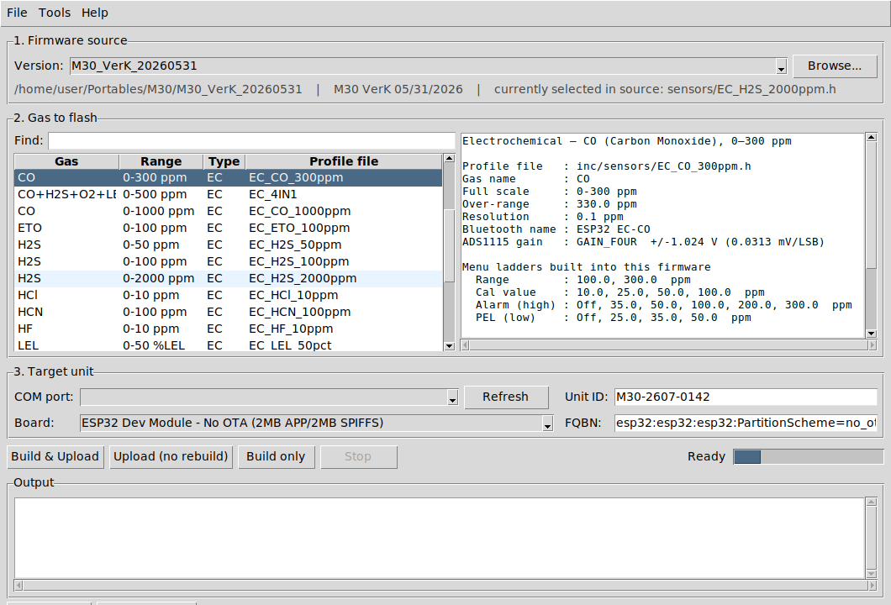

# M30 Gas Flasher

A Windows desktop program for building an M30 portable analyser unit as a
specific gas and flashing it to the unit's ESP32 — without opening the Arduino
IDE and without hand-editing `inc/SensorConfig.h`.

Pick the firmware version → pick the gas → pick the COM port → **Build & Upload**.



---

## What it actually does

The M30 firmware already supports every gas from one code base. Which gas a
unit is is decided by a single line in `inc/SensorConfig.h`:

```cpp
#include "sensors/EC_CO_300ppm.h"     // <- the active gas profile
```

That header sets `SENSOR_GAS_NAME`, the ADS1115 gain, the Bluetooth device
name, the default intercept/slope, and the range / alarm / PEL / cal-value menu
ladders. The `.ino` builds all of its menus from those macros.

For each flash the program:

1. **Copies** the sketch folder to a private work folder.
   The sources in the repository are *never* modified.
2. **Selects** the chosen gas in the copy's `inc/SensorConfig.h` — the wanted
   `#include` is uncommented, all others are commented out.
3. **Compiles** the copy with `arduino-cli` for the chosen board/FQBN.
4. **Uploads** the result to the selected COM port.
5. **Records** the flash in `flash_log.csv` (timestamp, unit ID, gas, profile,
   BT name, firmware version, port, result).

Builds are kept and keyed by a hash of the source tree, so flashing a second
unit with the same gas skips straight to the upload (a few seconds instead of
a couple of minutes). Change the gas — or the firmware — and it rebuilds.

---

## One-time setup on the Windows PC

1. **Install Python 3.10 or newer** from [python.org](https://www.python.org/downloads/windows/)
   (tick *Add python.exe to PATH*). The python.org installer includes tkinter,
   which the program needs; the Microsoft Store build is fine too.
2. **Install arduino-cli** — download the Windows zip from
   [arduino.github.io/arduino-cli](https://arduino.github.io/arduino-cli/latest/installation/)
   and either put `arduino-cli.exe` on your PATH, or drop it in a `tools\`
   folder next to this program, or point at it with *Tools > Locate arduino-cli*.
3. **Install the USB driver** for the unit's USB-serial chip (CP210x or CH340)
   if Windows does not already show a COM port when a unit is plugged in.
4. Start the program and run **Tools > Install / update ESP32 toolchain**.
   This installs the ESP32 core and every library the M30 sketch needs
   (`Adafruit ADS1X15` 1.1.1, `Adafruit INA219`, `Adafruit SHT4x`, ThingPulse
   `SSD1306`, `U8g2`, `ArduinoJson`, `MQTT`, `RTClib`). It downloads ~1 GB the
   first time and only needs doing once per PC.

### Running it

From source:

```
python M30Flasher.py
```

As a single `.exe` (build once, copy anywhere):

```
build_windows_exe.bat        →  dist\M30Flasher.exe
```

`pyserial` is optional — it only gives nicer COM-port names. Without it, ports
come from `arduino-cli board list`.

---

## Flashing a unit

| Step | What to do |
|------|------------|
| 1 | **Firmware source** — pick the version folder. The newest release M30 sketch is preselected; *Browse…* for anything else. The line underneath shows the folder, the `FW_VERSION` string, and which gas the source tree is currently set to. |
| 2 | **Gas to flash** — pick the gas. Type in *Find* to filter. The details pane shows exactly what the built firmware will contain: full scale, resolution, over-range, BT name, ADS gain and every menu ladder. The row highlighted in blue is the one currently selected in the source. |
| 3 | **Target unit** — plug the unit in, press *Refresh*, pick its COM port, and type the unit's serial number in *Unit ID* (it goes into the flash log). Leave *Board* on the default unless you know the unit needs something else. |
| 4 | Press **Build & Upload**. Watch the *Output* pane. |

Other buttons:

- **Upload (no rebuild)** — flash the build that is already in the cache for
  this gas. Use it for the second, third, … unit of the same gas.
- **Build only** — compile without a unit connected, e.g. to check a new
  profile header compiles.
- **Stop** — terminate the running compile or upload.

After the upload, verify on the unit: the run screen shows the gas name and
unit, and the Bluetooth device name matches the *BT name* in the details pane.
A newly flashed unit is uncalibrated — run Zero, then Cal Gas, per
`SENSOR_CONFIGS.md`.

---

## Adding a new gas

The program lists whatever is in `inc/sensors/`, so a new gas needs no change
here:

1. Copy `inc/sensors/EC_TEMPLATE.h` to `inc/sensors/EC_<GAS>_<range>.h` and
   fill in the `SENSOR_*` macros (see `M30_VerK_*/SENSOR_CONFIGS.md`).
2. Add a commented-out `#include "sensors/EC_<GAS>_<range>.h"` line to the
   list in `inc/SensorConfig.h`.
3. Restart the program (or reselect the firmware version) — the new gas appears.

Step 2 matters: the program only offers gases that are listed in
`SensorConfig.h`, and it will refuse to select a header that has no line there
rather than write one in a place it might not belong.

---

## Where things live

Everything the program writes lives under
`%LOCALAPPDATA%\M30GasFlasher\` (*File > Open work folder*):

| Path | Contents |
|------|----------|
| `settings.json` | Last used sketch, gas, board, port, unit ID |
| `staging\` | The working copy of the sketch that gets compiled |
| `buildpath\` | Incremental build directory (keeps rebuilds fast) |
| `firmware\<sketch>\<gas>\<hash>\` | Compiled `.bin` / `.elf` per gas |
| `flash_log.csv` | One row per flash — the production record |

Deleting the whole folder is safe; it is all rebuildable.

---

## Board settings

The default FQBN matches how the M-series firmware is built in the Arduino IDE:

```
esp32:esp32:esp32:PartitionScheme=no_ota,CPUFreq=240,FlashFreq=80,FlashMode=qio,FlashSize=4M,UploadSpeed=921600
```

That is *ESP32 Dev Module*, 4 MB flash, **No OTA (2 MB APP / 2 MB SPIFFS)**,
240 MHz, upload at 921600 baud. The BluetoothSerial + SPIFFS build does not fit
the default 1.2 MB app partition, which is why the partition scheme is set.

Pick a different preset from the *Board* list, or edit the *FQBN* box directly,
if a unit uses a different module. The FQBN is saved with the rest of the
settings.

**Which part of the FQBN actually matters.** The M30 sketch addresses every pin
by raw GPIO number (`12`, `13`, `14`, `19`, `25`, `5`, and `23`/`22` for the
OLED) and uses no board-specific macros — no `LED_BUILTIN`, no `A0`, no
`ARDUINO_*`. So the board identity (`esp32` vs `featheresp32`) does not change
the compiled code. What does matter is the **partition scheme**: the firmware
links in BluetoothSerial, WiFi, MQTT, the web server and SPIFFS, which will not
fit the default 1.2 MB app partition. If a build overflows, switch to the
*Huge App* preset; if a flashed unit boot-loops, the partition scheme is the
first thing to check.

Note that the available option names differ per board — if a preset is
rejected with *Invalid FQBN*, pick another entry from the *Board* list.

---

## Troubleshooting

| Symptom | Fix |
|---------|-----|
| *arduino-cli not found* | Install it, or *Tools > Locate arduino-cli*. |
| *Platform 'esp32:esp32' not found* | Run *Tools > Install / update ESP32 toolchain*. |
| `xxx.h: No such file or directory` | Same — a library is missing. |
| No COM ports listed | Check the cable (some are charge-only) and install the CP210x/CH340 driver. |
| *Access is denied* on the port | Close the Arduino Serial Monitor / any terminal on that port. |
| *Failed to connect to ESP32* | Hold BOOT, tap EN/RESET, release BOOT, upload again. Or drop `UploadSpeed` to 460800 in the FQBN. |
| *section exceeds available space* | Switch to the *Huge App* board preset. |

The program prints the exact `arduino-cli` command it runs at the top of every
step, so anything it does can be reproduced by hand.

---

## Development

```
python -m unittest discover -s tests -v
```

44 tests cover profile-header parsing, the `SensorConfig.h` rewriter (including
that the repository copy is never touched), staging, the build cache, the flash
log and the error hints. They use a stub in place of `arduino-cli`, so they run
anywhere — no ESP32 and no toolchain needed.

| Module | Responsibility |
|--------|----------------|
| `m30flasher/profiles.py` | Parse `inc/sensors/*.h` into `GasProfile` objects |
| `m30flasher/sketch.py` | Find sketches, read/rewrite the gas selector, stage, fingerprint |
| `m30flasher/toolchain.py` | Locate + drive `arduino-cli`, list serial ports |
| `m30flasher/flashjob.py` | Stage → select → compile → upload → log, plus error hints |
| `m30flasher/settings.py` | Persisted settings, board presets, library list |
| `m30flasher/gui.py` | The Tkinter window |
